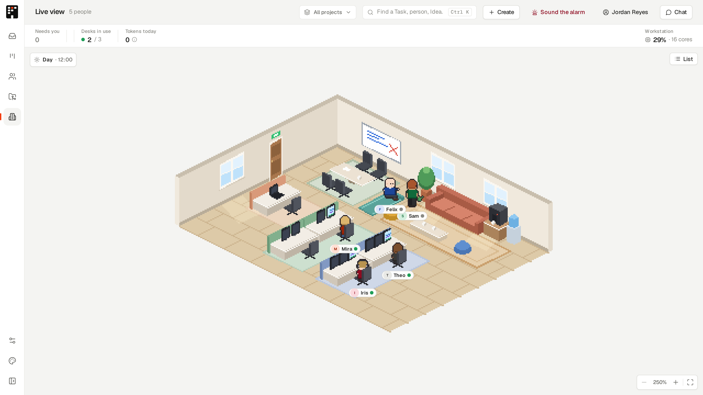
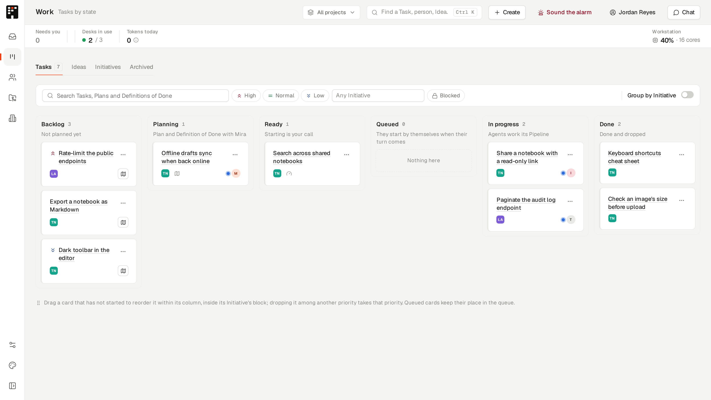
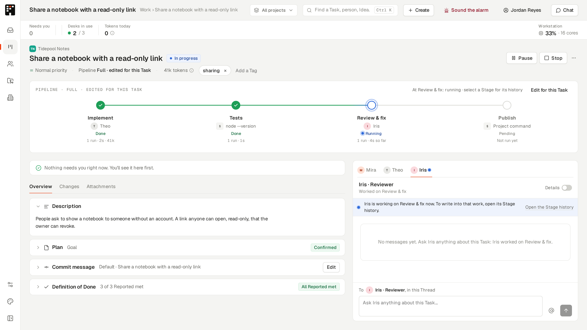
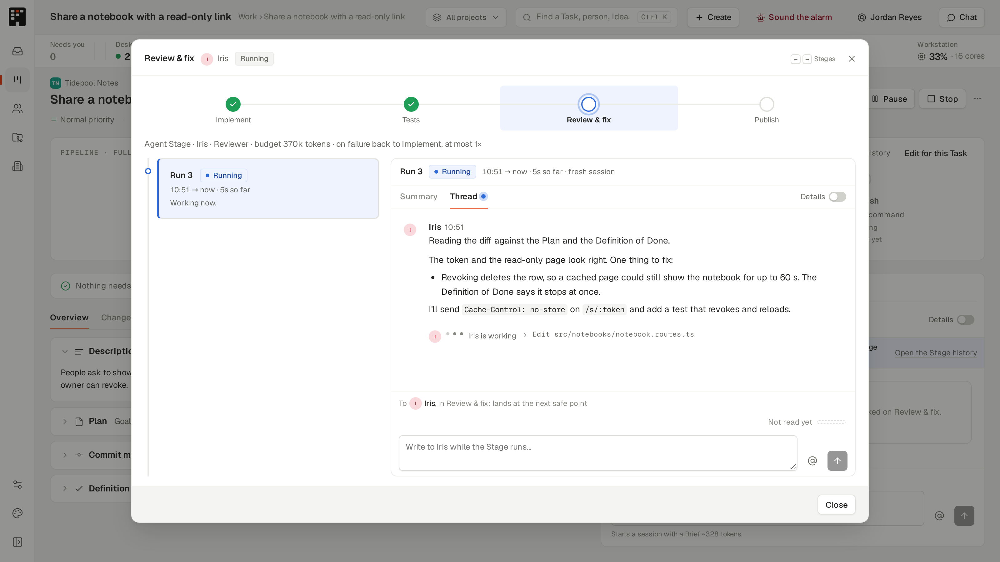

# The Office

[](https://buymeacoffee.com/przemczan)

The Office is a workspace for a few signed-in users, run like an office. You hire people for Roles (a Planner, a Developer, a Reviewer, a CTO), and they are AI Agents working on your Projects. Work comes in as Tasks, each going through a Pipeline of Stages, in its own git worktree and run environment, while you make the decisions that are yours and approve what goes out.



The Live view: who is working, idle or waiting on you, at a glance. A click on someone opens their work.



Work: every Task by its state, from Backlog through Planning and Ready to In progress and Done.



A Task in progress: its Pipeline's Stages, who works each, the Plan, the Definition of Done and the conversation with each person.



A running Stage's Thread, where you can write to the person while they work.

## What you need

- **A machine:** Linux on x64 or arm64, with systemd and root (direct install) or Docker Engine with Compose (Compose install); port 4310, and 4400–4419 for test instances (open them in the firewall only to reach test instances from your network). The Office reaches Docker, which is root access to the machine, so give it a machine of its own. On Windows and macOS, run it from a checkout (below).
- **An engine** for the Agents to run on: a Claude Code account, a Codex account, or an API endpoint on the OpenAI-compatible API. You sign in during First-run setup or later in Settings › Engines.
- **GitHub, optionally:** Sign in with GitHub gives The Office its own git identity, for cloning, pushing and pull requests on GitHub. Projects elsewhere work without it.

[docs/installing.md](docs/installing.md#requirements) lists the requirements in full.

## Install

On Debian 12/13 or Ubuntu 22.04/24.04, as a systemd service:

```sh
curl -fsSL https://github.com/przemczan/the-office/releases/latest/download/install.sh | sudo bash
```

On any Linux machine with Docker Engine and Compose, in a new folder:

```sh
curl -fsSLo docker-compose.yml https://github.com/przemczan/the-office/releases/latest/download/docker-compose.yml && curl -fsSLo .env https://github.com/przemczan/the-office/releases/latest/download/the-office.env
# fill in .env, then:
docker compose up -d
```

[docs/installing.md](docs/installing.md) walks through both, with configuration, backups, updating and uninstalling.

### From a checkout

On Windows, macOS or Linux, and to work on The Office itself, with Node at `.nvmrc`'s version, git, and Docker with Compose:

```sh
git clone https://github.com/przemczan/the-office.git
cd the-office
npm ci
cp .env.example .env
docker compose up -d --wait postgres
npm run build
npm start
```

[docs/running-the-office.md](docs/running-the-office.md#running-from-a-checkout) says what `.env` holds and how `npm start` runs.

## First run

1. Open The Office at the address the install printed.
2. Give it the setup token the install printed, with your name, email and password, to create the first user.
3. First-run setup walks through the engine, Sign in with GitHub and telemetry; skip any of them and set it later in Settings.

Then hire your first people in People, add a Project, and create a Task. [docs/installing.md](docs/installing.md#first-run) has the details, and how to get a new setup token.

## Docs

- [Installing](docs/installing.md): both installs, first run, configuration, backups, updating, uninstalling.
- [Running The Office](docs/running-the-office.md): a checkout, a reverse proxy, signing in, telemetry, how an Office update works.
- [Container runtime](docs/container-runtime.md): the Docker Engine The Office runs on and what run environments mount.
- [Releasing](docs/releasing.md): how an Office release is cut and what it carries.
- [The spec](docs/spec/README.md): what The Office is meant to do, section by section.

The screenshots above show a demo Office; `npm run build && npm run readme-screenshots` makes them again.

## Support

If The Office is useful to you, you can support its work:

[](https://buymeacoffee.com/przemczan)

## License

[GPL-3.0-only](LICENSE).
